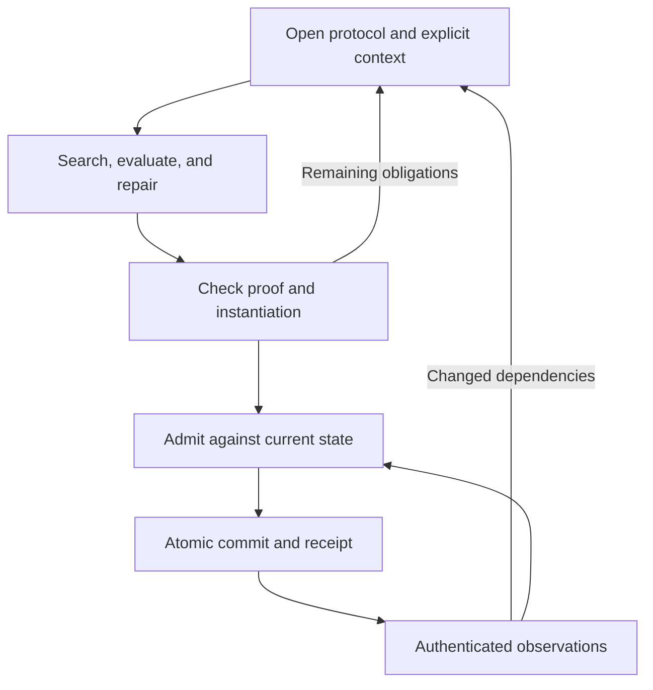

# THE THREE GPT-6 DOCUMENTS ON CONTEXTUAL/MODAL TYPES, HOLES, REPAIR — RAW, as Ember pasted them (real 2026-10-20 07:24Z; the condensed version is ACTIVITIES-PROPOSAL-20261022.md)

soo... got something real interesting for us to consider:

<gpt6>


Yes :) **The part I’d put at the center is your “repair hints”: a reasoning object that remembers both why it currently works and where to resume reasoning if those reasons change.** That gives “changing your mind” a computational structure.

I read three connected ideas in your notes:

- **Justifications remain inspectable:** which assumptions support this judgment?
- **Alternatives remain available:** what else could support it, and why wasn’t that alternative selected?
- **Instantiation remains revisable:** where did we commit to a particular term, representation, or proof, and can we reopen that commitment?

The third makes your guarded holes especially interesting. A hole could be a persistent place where a decision is made, carrying an interface, conditions for admissible fillings, and enough retained structure to replace a filling later.

There are some remarkably direct antecedents. I found a paper literally called *First-class substitutions in contextual type theory*, and the original ATMS paper discusses retaining partially attempted reasoning that might become useful after a context change. I think we can use those to make your proposal quite precise while keeping the unexplored parts visible.

What follows is **my proposed reconstruction of your notes**, rather than an assertion that this is already your intended calculus.

## 1. Dilly’s distinction is useful, but your proposal introduces another operation

The distinction between updating an analysis and giving a language defeasible assumptions is real. Removing a premise can invalidate a derivation even in a perfectly monotonic logic:

\[
\Gamma,A\vdash B
\]

doesn’t imply

\[
\Gamma\vdash B.
\]

Defeasible reasoning adds another possibility: **adding** information can defeat a previously licensed conclusion.

Your repair machinery could operate across both, while introducing a further operation:

> Preserve the obligation, reopen the choice of how to satisfy it, and attempt another checked construction.

Suppose a program contains a membership query over an immutable vector `xs`. Its exported contract is:

\[
\operatorname{SearchResult}(xs,k)
=
\{b:\mathbf{Bool}\mid b=\mathrm{true}\leftrightarrow k\in xs\}.
\]

Assume the element type has a decidable total order. We retain two implementations:

```text
binary:
    requires evidence that xs is sorted
    establishes SearchResult(xs, k)

linear:
    requires no sortedness evidence
    establishes SearchResult(xs, k)
```

Initially, an accepted premise `s : Sorted(xs)` makes `binary` eligible, and a selection policy prefers it.

Now withdraw `s`.

A useful report would distinguish several things:

| Object | Status after withdrawing `s` |
|---|---|
| `Sorted(xs)` | Its recorded justification is unavailable |
| `NotSorted(xs)` | No evidence has been supplied |
| Binary-search candidate | Its sortedness obligation is open |
| Linear-search candidate | Still eligible |
| Membership contract | Can remain established through the linear candidate |
| Previously established logarithmic cost bound | Needs separate reconsideration |

That one transition contains **recovered uncertainty, a changed implementation choice, and preservation of a higher-level judgment**.

If the linear implementation is only partly constructed, the result could instead become:

```text
membership query:
    suspended at guarded hole h

remaining obligation:
    complete the linear-search correctness argument

retained work:
    input representation, equality procedure,
    unaffected client derivations, previous search residual
```

That seems close to what your terms are reaching toward: the language has a representation for a computation whose justification has become incomplete, and operations for repairing that incompleteness.

There is also a direct Houyhnhnm connection. *Non-Stop Change* treats code/data changes as first-class transactions, discusses types tracking temporary incoherence, and emphasizes preserving information about the intended change. Your proposal would give part of that architectural vision a proof-theoretic account. [ngnghm.github.io](https://ngnghm.github.io/blog/2015/09/08/chapter-5-non-stop-change/?utm_source=chatgpt.com)

## 2. The crucial dependency is often the reason an alternative was discarded

A first approximation is to retain all known supports for a judgment.

Suppose:

\[
a\land b\Rightarrow J,
\qquad
c\Rightarrow J.
\]

We can represent the provenance of \(J\) as

\[
P_J=ab+c,
\]

where multiplication records joint requirements and addition records alternative derivations. That interpretation is the core of provenance semirings. [cs.ucdavis.edu](https://www.cs.ucdavis.edu/~green/papers/pods07.pdf?utm_source=chatgpt.com)

Then:

- Retracting \(a\) removes one route, while \(c\) can keep \(J\) established.
- Retracting \(c\) as well leaves no recorded applicable route.
- Reintroducing suitable evidence for \(a\) can reactivate the first route without reconstructing it.

Already, “invalidating a proof” and “invalidating its conclusion” are different operations.

But your repair hints suggest retaining something further:

```text
candidate P was not pursued because:
    candidate Q was cheaper under assumption a

candidate R was pruned because:
    constraint c made this branch inconsistent

candidate S was suspended because:
    obligation G had no available witness
```

Now a change can affect the **reason for suppressing a branch**.

If `a` disappears, `P` may become preferable. If `c` disappears, the justification for pruning `R` disappears. If a witness for `G` arrives, `S` can resume.

A graph containing only successful derivations misses those dependencies.

This is strikingly close to a passage in de Kleer’s 1986 *An Assumption-Based TMS*. He explicitly asks where reasoning should resume after a context change, discusses failed or partially attempted rules that may now succeed, and identifies unrecorded control decisions as a source of missed solutions or redundant recomputation. His proposed interface makes those decisions visible to the maintenance system. [dekleer.org](https://www.dekleer.org/Publications/An%20Assumption-Based%20TMS.pdf?utm_source=chatgpt.com)

So I would sharpen your proposal this way:

> **Record the justification for a commitment, including commitments to stop searching, discard a branch, or prefer one candidate.**

That gives a “repair hint” several possible meanings:

| Retained object | What it enables |
|---|---|
| Another completed derivation | Switch to a surviving justification |
| A conditional derivation | Reactivate it when its assumptions become available |
| A partial derivation | Resume at its open obligations |
| A proof transformation | Adapt an existing derivation to a changed interface |
| A pruning explanation | Reopen alternatives when their exclusion loses support |

These deserve different representations. A completed conditional proof has stronger guarantees than a promising tactic.

There is a particularly relevant modern connection in Grädel and Tannen’s *Provenance Analysis and Semiring Semantics for First-Order Logic*. It covers reverse provenance, updates, missing answers, and repairs. One of its useful lessons is that specializing an expression to the current situation can erase branches needed to explain later updates. Their treatment of negation requires richer provenance than ordinary positive polynomials. [arxiv.org](https://arxiv.org/html/2412.07986v1?utm_source=chatgpt.com)

That is also a good description of the danger in premature substitution: **you can erase the place where a future change needs to act.**

## 3. “Resubstitution” needs an object that survives substitution

Here is a tiny information-loss example.

Consider:

```text
template₁ = x + 1
environment₁ = { x ↦ 2 }

template₂ = 3
```

Both evaluate to `3`.

Now revise the binding of `x` to `4`. The first should become `5`; the second should remain `3`. The bare result cannot tell us which operation to perform.

A revisable computation therefore needs to retain something like:

\[
\left\langle
t,\;
\Gamma,\;
\sigma,\;
v,\;
\text{dependency/residual structure}
\right\rangle,
\]

where:

- \(t\) is the open template;
- \(\Gamma\) describes its interface;
- \(\sigma\) is its current instantiation;
- \(v\) is the current result;
- the residual structure records which work depended on which choices.

Then your operation can have the intended meaning:

\[
\langle t,\sigma,\ldots\rangle
\rightsquigarrow
\langle t,\sigma',\ldots\rangle.
\]

This replaces a remembered instantiation. Ordinary composition of substitutions addresses a different question: how a subsequent substitution acts on the variables remaining in the already-substituted expression.

### There is an exact literature connection for abstraction over substitutions

Cave and Pientka’s [*First-class substitutions in contextual type theory*](https://www.cs.mcgill.ca/~bpientka/papers/lfmtp13.pdf) introduces substitution variables and allows programs to abstract over substitutions, pass them as arguments, and return them as results. Its substitutions relate typed contexts, and the work connects this machinery to Beluga. [cs.mcgill.ca](https://www.cs.mcgill.ca/~bpientka/papers/lfmtp13.pdf?utm_source=chatgpt.com)

That gives your phrase “substitution abstraction” at least two readings:

1. **Parameterize a construction over a typed substitution.** There is a concrete foundation for this.
2. **Recover a parameterized construction from an already-specialized result.** This is generally ambiguous, as the `3` example shows.

Retaining the abstraction boundary from the beginning makes the second problem much less mysterious.

### The important obstruction: arbitrary retraction is not a typed substitution

Fix the convention that

\[
\sigma:\Delta\Rightarrow\Gamma
\]

assigns a suitably typed term in \(\Delta\) to each variable declared in \(\Gamma\). The substitution principle says:

\[
\Gamma\vdash t:A
\quad\land\quad
\Delta\vdash\sigma:\Gamma
\quad\Longrightarrow\quad
\Delta\vdash t[\sigma]:A[\sigma].
\]

Now take:

\[
\Gamma=(a:A),\qquad t=a,
\]

and withdraw \(a\), leaving \(\Delta=\varnothing\).

A substitution from the empty context into that interface would need to supply a **closed witness of \(A\)**. Withdrawing the assumption supplies no such witness.

This gives your guarded holes a precise job. They can represent the point where transport becomes partial:

- A replacement witness exists: fill the missing component.
- A conditional construction survives: retain it under its remaining interface.
- A search remains possible: expose the obligation and its residual.
- A contradiction is established: report the contradiction with its own evidence.

A failed repair attempt supplies no proof that \(A\) is false.

Dependent contexts make the obstruction more visible:

\[
n:\mathbb N,\quad
xs:\operatorname{Vec}(T,n),\quad
i:\operatorname{Fin}(n).
\]

Changing \(n\) can require coordinated changes to the later components. A guard can express the obligation needed to reuse `i`; it cannot make an out-of-range index valid.

This is where proof repair across type equivalences fits. PUMPKIN Pi supplies checked transformations across suitable equivalences. An arbitrary assumption withdrawal may have no corresponding equivalence or transport. [arxiv.org](https://arxiv.org/abs/2010.00774?utm_source=chatgpt.com)

## 4. A guarded hole could be a persistent interface to a family of constructions

One plausible representation is:

```text
hole h:
    local context
    required type / behavioral contract
    candidate fillings
    applicability conditions for each candidate
    currently selected filling
    suspended searches and repair procedures
    dependencies of selection and pruning decisions
```

The stable identity belongs to the hole. Its filling can change.

An occurrence might be written schematically as:

\[
h[\theta],
\]

where \(\theta\) instantiates the hole’s local context at that occurrence. A candidate filling \(u\) must satisfy the required type and guard after the relevant instantiations.

This separates two operations that are easily conflated:

- Changing the candidate assigned to `h`.
- Changing the environment in which an occurrence of `h` is used.

Both can require repair, and they can interact.

For example, a candidate may remain valid in its own context while a particular occurrence loses the evidence needed to instantiate that context. Conversely, all occurrences may remain well formed while the selected candidate itself becomes ineligible.

Hazelnut Live provides a useful operational foundation: its hole closures retain environments, evaluation can continue around holes, and filling a hole can resume evaluation. Its metatheory establishes properties of this fill-and-resume behavior. Reopening a previously filled and consumed dependency would require additional revision semantics. [arxiv.org](https://arxiv.org/abs/1805.00155?utm_source=chatgpt.com)

### What should a repair procedure return?

I would give it several explicit outcomes:

```text
Verified:
    replacement construction
    checked evidence for the required interface

Suspended:
    remaining obligations
    reusable partial construction
    continuation of search

Conflict:
    incompatible evidence or constraints
    explanation of the conflict
```

It may also return multiple candidates or a lazy search over them.

A heuristic repair hint should be allowed to be incomplete, expensive, or unsuccessful. **Its proposed replacement acquires authority through checking.** This permits fairly adventurous repair search without making the search engine part of every proof’s trusted justification.

PUMPKIN’s earlier proof-repair work is relevant here too: it searches changes in proofs and specifications for reusable patches, with operations including abstraction and specialization. Your direction would bring such transformations into the persistent representation of the reasoning process. [dependenttyp.es](https://dependenttyp.es/pdf/pumpkinpaper.pdf?utm_source=chatgpt.com)

There is also a beautiful connection to *A Coinductive Approach to Proof Search through Typed Lambda-Calculi*: it represents proof-search alternatives using formal sums and fixed points, and proves a finitary representation result for its intuitionistic implicational setting. That is an example of making a solution space itself into a typed mathematical object. The restriction to that setting matters; it does not give a finite representation theorem for arbitrary dependent proof search. [arxiv.org](https://arxiv.org/abs/1602.04382?utm_source=chatgpt.com)

## 5. The ludics connection becomes useful when the guard describes admissible interaction

Here is where I think your ludics intuition can do real work.

In ludics, orthogonality expresses successful interaction between a design and an appropriate counterdesign or net. For a family of counter-interactions \(\mathcal T\),

\[
\mathcal T^\perp
=
\{d\mid \forall t\in\mathcal T,\ d\perp t\}.
\]

Behaviors are closed under biorthogonality. [arxiv.org](https://arxiv.org/pdf/1307.1028?utm_source=chatgpt.com)

A proposed interpretation of a guarded hole is then:

> The hole specifies the interactions a filling must support, under the current assumptions.

Write those obligations as \(\mathcal T_{h,w}\), indexed by hole \(h\) and world or revision \(w\). Eligible fillings could be characterized schematically by:

\[
F_{h,w}
=
\{d\mid
d\text{ meets the required admissibility conditions}
\;\land\;
d\in\mathcal T_{h,w}^{\perp}
\}.
\]

Now consider adding an interaction obligation \(t\):

\[
\mathcal T'=\mathcal T\cup\{t\}.
\]

Then:

\[
F'=F\cap\{t\}^{\perp}.
\]

A revision changes the demands at an interface, and some existing fillings cease to meet them.

For a mundane example, withdrawing “the caller always supplies a non-null value” enlarges the possible caller behaviors. A filling must now tolerate an additional interaction, obtain a new precondition, insert a check, or become suspended.

That offers a way to understand repair **through the obligations at an interaction boundary**.

### Two distinctions matter here

First, a finite set of interactions you have tried generally gives an overapproximation of admissibility. If

\[
\mathcal T_{\mathrm{tested}}\subseteq\mathcal T_{\mathrm{required}},
\]

then

\[
\mathcal T_{\mathrm{required}}^\perp
\subseteq
\mathcal T_{\mathrm{tested}}^\perp.
\]

Passing every performed test can leave additional candidates that fail an untested required interaction. A proof or completeness result is needed to close that gap.

Second, **an unresolved hole needs a success criterion distinct from a completed implementation**. In the original ludics setting, successful closed interaction reaches the daimon, and certain replacements by daimon preserve behavior membership. Consequently, directly using a daimon-like placeholder as a “repaired program” could validate an object that simply gives up. The language needs an explicit distinction between acceptable partial interaction and a completed proof or computation. [arxiv.org](https://arxiv.org/pdf/1307.1028?utm_source=chatgpt.com)

Transcendental syntax supplies another useful angle. Eng and Seiller’s stellar-resolution formulation builds interaction from first-order terms and unification, with separate proof-like conditions in its logical correspondence. [arxiv.org](https://arxiv.org/pdf/2007.16077?utm_source=chatgpt.com)

My inference for your project is that changing a substitution can change **which interactions are possible**, including which pieces connect. This helps explain your observation that some repairs are local and others are not: the revision may change the interaction graph itself.

## 6. Local repair needs a boundary theorem

I think “some changes repair locally” can be turned into a useful formal target.

A syntactically small change can have extensive consequences. Conversely, a large internal reconstruction can preserve everything a client depends on.

The relevant question is:

> What does a consumer rely on at this boundary, and does the replacement preserve it?

There are several strengths of answer:

| Preserved property | What can potentially be reused |
|---|---|
| The same typing interface | Client typing derivations |
| The same logical contract | Client proofs using that contract |
| The same observable behavior | Cached downstream observations |
| The same cost/resource guarantees | Bounds and scheduling decisions using them |

These are different reuse claims.

In the search example, binary and linear search establish the same Boolean membership answer for the same immutable input. Client reasoning about membership can survive. A latency guarantee may not.

With dependent types, even replacing one inhabitant of a type with another can affect types that mention that inhabitant. A locality result therefore needs to specify abstraction, dependency, and any required transport. “Both have type `A`” is not always enough to preserve every downstream artifact.

A useful design discipline would be:

> Every reusable boundary declares the observations it preserves, and a repair either re-establishes that declaration or propagates an obligation beyond it.

This also reveals why pruning explanations matter. Suppose a solver discarded an enormous region because a constraint made it impossible. Withdrawing that constraint can reopen the region. The relevant boundary was the exclusion argument, even if the selected answer had only a small dependency trace.

### Effects introduce another boundary

A repaired justification changes what the system can support now. It does not erase an already performed interaction.

For an effectful language, I would distinguish:

- Revisable descriptions and proofs.
- Currently authorized actions.
- The record of actions already performed.
- Explicit compensation or migration operations.

A consumed linear resource remains consumed. An alternative computation can be retained as code without retaining another copy of its live resources.

That follows directly from taking Dilly’s “not undo” seriously: changing one’s mind changes future commitments while preserving an account of what has already happened.

## 7. Differential dataflow can maintain the machinery, while the language specifies its meaning

Differential dataflow gives you an implementation substrate for maintaining changing collections through iterative computation. Its update weights can express additions and removals. A negative update to a collection entry records removal; it does not constitute logical evidence for the negation of that entry. [frankmcsherry.org](https://www.frankmcsherry.org/differential/dataflow/2015/04/07/differential.html?utm_source=chatgpt.com)

You could use it to maintain relations such as:

```text
candidate establishes judgment under support
guard depends on evidence
candidate is blocked by constraint
consumer relies on interface
repair residual waits on obligation
```

The semantic decisions remain explicit:

- What constitutes a valid justification?
- When does absence license a default?
- Which alternative worlds are admissible?
- Is selection skeptical, permissive, prioritized, or left unresolved?
- When is a computation complete enough to execute?

Two tiny examples expose why those choices matter.

### A cycle must lose support when its grounding disappears

```text
p :- a.
p :- q.
q :- p.
```

With `a`, both `p` and `q` follow.

Withdraw `a`. Under least-fixed-point semantics, neither survives. Counting immediate incoming justifications naively can leave them supporting each other indefinitely.

The repair mechanism needs grounded derivations or suitable fixed-point treatment.

### Alternative worlds must retain their separation

```text
p :- not q.
q :- not p.
```

Under stable-model semantics, this has alternatives `{p}` and `{q}`. Keeping both alternatives does not justify asserting their union as one world. Stable-model semantics supplies a precise account of this distinction. [cs.utexas.edu](https://www.cs.utexas.edu/~ai-lab/pubs/13defs.pdf?utm_source=chatgpt.com)

For your system, that means at least three situations deserve different reports:

- Neither `p` nor its negation has an applicable recorded justification.
- Different admissible worlds support incompatible possibilities.
- One proposed world contains conflicting evidence.

There is also a fourth operational situation: the analyzer has not finished determining which of those holds.

I would preserve these distinctions in the representation. They influence which repair operations are appropriate.

And I would keep assumption identities stable. Withdrawing `a₇ : A` should change its applicability. Quietly mutating `a₇` to mean another proposition would corrupt every stored derivation that mentions it. Immutable, versioned premises make historical and current validity intelligible.

## 8. The strongest formulation may be an algebra of checked repair

There is an appealing analogy with incremental computation.

The incremental lambda-calculus literature studies derivatives that turn changes in inputs into changes in outputs, with a correctness relationship between incremental execution and recomputation. [arxiv.org](https://arxiv.org/abs/1312.0658?utm_source=chatgpt.com)

Your corresponding object could be a repair operation indexed by an edit:

\[
e:w\rightsquigarrow w',
\]

\[
\operatorname{repair}_e:
\operatorname{State}(w)\to\operatorname{State}(w').
\]

Here a state includes checked constructions, alternatives, and open obligations. It must permit a formerly completed judgment to become suspended.

For a restricted analysis with a fixed selection policy, a desirable theorem is:

\[
\operatorname{observe}_{w'}
\bigl(\operatorname{repair}_e(S)\bigr)
=
\operatorname{observe}_{w'}
\bigl(\operatorname{analyzeFromScratch}(w')\bigr).
\]

Both sides live in the new world, so this comparison can use the new world’s output types.

If selection intentionally depends on history, the reference semantics must receive that history too. If the semantics retains multiple solutions, compare the admissible solution sets or another specified observation, rather than demanding an arbitrary chosen proof be identical.

There is relevant precedent for the analysis part: *Demanded Abstract Interpretation* handles incremental and demand-driven analysis with cyclic dependencies and widening, proving preservation of soundness and termination and agreement with its batch analysis. [arxiv.org](https://arxiv.org/abs/2104.01270?utm_source=chatgpt.com)

But agreement with recomputation is only one obligation. Recompute-everything satisfies it.

For your design, I would want three separate results:

1. **Conditional soundness:** every active judgment has checked evidence under the assumptions and guards it declares.
2. **Repair correctness:** the repaired state has the specified relationship to the new-world semantics.
3. **Locality:** under stated boundary conditions, repair need not inspect or rebuild the rest of the system.

The third is where retained repair structure earns its keep.

### What would make the repair objects first-class?

I’d want to be able to:

- Pass a repair procedure to another construction.
- Abstract over the substitutions or edits it handles.
- Compose repairs and expose their intermediate obligations.
- Compare alternative repairs under an explicit cost or intent policy.
- Preserve a repair residual when no candidate currently succeeds.
- Check a proposed replacement independently of how it was found.

That starts to look like a language for maintaining constructions through change.

## 9. A small experiment could expose the central problems

I would begin with a small typed core, named contextual holes, immutable assumption tokens, and a finite rule fragment. Keep a from-scratch reference implementation alongside the incremental one.

Then make these cases work:

| Experiment | Required outcome |
|---|---|
| Withdraw one of two independent supports | The judgment survives through the other |
| Withdraw the last known support | The judgment becomes unsupported or suspended, without acquiring a negation |
| Withdraw the reason a branch was pruned | The branch becomes available for reconsideration |
| Remove the grounding of a positive cycle | The cycle loses support |
| Change a component of a dependent context | Dependent substitutions are repaired or expose obligations |
| Replace a filling while preserving its exported contract | Unaffected client proofs remain usable |
| Preserve correctness but lose a cost guarantee | The two properties receive separate statuses |
| Reapply an earlier filling | Its retained structure is reused where still valid |

The most revealing measurements would concern **why work was revisited**: invalidated supports, reopened branches, discharged obligations, changed interfaces, and preserved boundaries. Runtime matters, but those measurements would tell you whether the representation captures the intended semantics.

There is a resource tradeoff to make explicit too. Keeping every possible future repair is generally infeasible. A system can retain a compact shared representation, known alternatives, and suspended searches, while exposing its completeness limits. “No retained repair succeeded” should remain distinguishable from “a proof establishes that this obligation cannot be satisfied.”

Of the papers above, I would put three directly beside your notes:

- [**First-class substitutions in contextual type theory**](https://www.cs.mcgill.ca/~bpientka/papers/lfmtp13.pdf), for the abstraction and context machinery.
- [**An Assumption-Based TMS**](https://www.dekleer.org/Publications/An%20Assumption-Based%20TMS.pdf), especially its discussion of partially attempted rules and recorded control decisions.
- [**Provenance Analysis and Semiring Semantics for First-Order Logic**](https://arxiv.org/html/2412.07986v1), especially reverse provenance and repairs.

The question I find most fertile in your proposal is:

**Can a reasoning node expose a typed interface for the ways its own commitment can be revised?**

That interface could say what remains fixed, which evidence may change, which alternatives are already available, and which obligations a replacement must discharge. Your guarded holes would be the persistent places where those interfaces live.

And the piece I would be especially reluctant to erase is **the reason an alternative was set aside**. When a premise changes, that reason may be exactly where the next useful computation begins.


Yes :) Reading these together, I think the productive connection is **an open protocol as a typed, inspectable family of possible continuations, with explicit obligations for making a particular continuation executable**.

Mini already has several substantial pieces of that story: checked instantiation of open templates, response-dependent programs, selective transport of authorization evidence, dependency-based validity, and durable obligations. Contextual type theory could help connect those pieces into a language where “replace this assumption or participant, and tell me what remains justified” has a precise meaning.

I read the documents alongside their Lean and Rust definitions at [dregg `22fad151`](https://github.com/emberian/dregg/tree/22fad151e9f118e3aa001a823e075918ffa139e8) and [minidregg `334316d`](https://github.com/emberian/minidregg/tree/334316df5653a846ed5d6069bbfb282bc4d5fcf6). This is a source-level reading; I haven’t compiled those snapshots. The proposed judgments below are my synthesis.

## 1. There are several different ways a protocol can be open

I would begin by distinguishing these, because they require different operations:

| Kind of openness | Example | What resolves or advances it |
|---|---|---|
| **An unspecified component** | A provider, price, implementation, witness, or contribution has not been supplied | Typed substitution or instantiation |
| **An interaction with an environment** | A peer may accept, refuse, respond differently, or remain silent | Composition with a participant satisfying an interface |
| **An unfinished execution** | A request has been dispatched, but its outcome is unresolved | A transition that preserves the existing history and outstanding obligations |

A contextual type addresses the first row directly. Using the notation \([\Psi\vdash A]\), it packages something of type \(A\) whose permitted dependencies are explicitly described by \(\Psi\). An explicit substitution supplies that environment. This is the central connection in Nanevski, Pfenning, and Pientka’s **Contextual Modal Type Theory**: metavariables and substitutions become objects with a disciplined account of scope and dependency. [cs.cmu.edu](https://www.cs.cmu.edu/~fp/papers/tocl07.pdf?utm_source=chatgpt.com)

For protocols, I would explore a judgment schematically like:

\[
\Omega;\Gamma;\Delta
\vdash P:\mathsf{Protocol}_{\Sigma}(i,A)
\;\dashv\;\Phi.
\]

Here:

- \(\Omega\) declares the unresolved components and their interfaces.
- \(\Gamma\) contains reusable data, handles, and evidence.
- \(\Delta\) contains resources whose use must be accounted for.
- \(\Sigma\) describes the available interactions; \(i\) is the current protocol index.
- \(\Phi\) records the obligations still needed for particular completions or actions.

A hole could then carry a contextual interface:

\[
u::[\Gamma_u;\Delta_u\vdash \mathsf{Protocol}(I_u)].
\]

This says what a replacement may depend on, what resources it may use, and what interface it must implement. Additional obligations can specify guards, authority, shared transaction parameters, and who controls the choice.

That last part matters. An unknown implementation that **we may choose** and a response that **another participant may choose** cannot have interchangeable meanings.

There is also an important distinction between a hypothetical context and a future runtime state. Adding a variable to a typing context is structural weakening. Moving to a later epoch can revoke authority or consume a resolution token. A contextual modality does not, by itself, transport present authorization into every future state.

## 2. Mini already has two particularly useful foundations

### Open templates have a checked instantiation discipline

The [modular typing document](https://github.com/emberian/minidregg/blob/334316df5653a846ed5d6069bbfb282bc4d5fcf6/docs/objective-bend/MODULAR-TYPING.md) describes declarations checked against rigid `Self` and `Super` bounds. A component can require certain members while leaving the eventual larger object unspecified. Composition and closure supply the missing structure.

The substantial connection is the actual [`Discharges.check_instantiate`](https://github.com/emberian/minidregg/blob/334316df5653a846ed5d6069bbfb282bc4d5fcf6/Theory/ObjectiveBendTemplates.lean#L1033-L1040) theorem. A checked template remains accepted after a substitution that satisfies `Discharges`, with valid instance assumptions and sufficient lookup fuel. The discharge conditions preserve required member lookup, row structure, shareability, and other assumptions.

That is already a concrete instance of:

> Check a component against its declared assumptions; reuse the check when a later environment demonstrably satisfies them.

Its present scope is type instantiation into checked templates. A first-class contextual package would extend this toward persistent values containing an open term, its interface, and an explicit environment.

For partial protocols, the analogous requirements might be:

- This role can obtain a quote.
- This continuation receives an authenticated result.
- This participant supplies a particular resource.
- This implementation preserves the obligation associated with an invocation.

The important move is to make these requirements part of the component’s interface, so that later composition has something precise to discharge.

### Responses already determine the continuation’s type

[`Theory/IndexedProgram.lean`](https://github.com/emberian/minidregg/blob/334316df5653a846ed5d6069bbfb282bc4d5fcf6/Theory/IndexedProgram.lean) supplies the other half. Its signature contains operations available at an index, a response type for each operation, and a next index determined by the response.

Schematically:

\[
k:
\prod_{r:\mathsf{Resp}(op)}
\mathsf{Program}\;\Sigma\;A\;(\mathsf{next}(op,r)).
\]

This represents a continuation appropriate to **each actual response**. Its small example makes `tick` available only after a successful choice moves the program into the required state.

The accompanying `fold_fusion` and `fold_rel` results are useful too: they provide conditions under which different interpretations of a program correspond. That gives a route toward relating a planner, symbolic analyzer, and executor through an explicit interpretation theorem.

The [Activity design](https://github.com/emberian/minidregg/blob/334316df5653a846ed5d6069bbfb282bc4d5fcf6/docs/OBJECTIVE-BEND.md) adds the operational example: a computation yields a plan and resumes on a typed response. Its counter increment can return the increased count after a successful write or the original count after refusal.

Together, these suggest a contextual package containing a protocol continuation that can be instantiated, inspected, and eventually run. The inductive `Program` model and an ongoing activity still need their respective execution semantics; contextual packaging does not settle that choice automatically.

## 3. Guarded holes give an admission boundary, while planning can remain more open

Dregg’s implemented [`GuardedHole`](https://github.com/emberian/dregg/blob/22fad151e9f118e3aa001a823e075918ffa139e8/metatheory/Dregg2/Exec/GuardedHole.lean) fixes a field, actor, target, and guard list, then accepts an integer later. Its successful-fill theorem connects the result to the underlying state step and successful predicate checks. This is a useful, deliberately narrow value hole.

Mini’s [`GuardedAdvice`](https://github.com/emberian/minidregg/blob/334316df5653a846ed5d6069bbfb282bc4d5fcf6/Theory/GuardedAdvice.lean) fixes a richer specification: identity, value code, turn, pre-root, authority demand, footprint, commitments, deadline, continuation, and nullifier domain. Advice is dependently typed by that specification. Its commit model checks the retained root and consumption state.

The question raised by the older [guarded-holes study](https://github.com/emberian/dregg/blob/22fad151e9f118e3aa001a823e075918ffa139e8/metatheory/docs/GUARDED-HOLES-METATHEORY.md) is whether a stronger hole may leave the contribution’s **shape** undetermined.

I think its “eager shape, lazy witness” boundary needs a staging qualification:

**An admitted transition needs a complete, authorized interpretation. An unfinished plan can describe a family of such transitions.**

For example, an open service plan might eventually require a package:

\[
\sum_{p:\mathsf{Provider}}
\sum_{c:\mathsf{Contribution}(p)}
\mathsf{Implements}(p,c,I).
\]

The provider and contribution may remain unknown during planning. A completion supplies them, establishes the interface, determines the concrete effects and footprint, and produces the appropriate admission object.

That does not require committing an outstanding imbalance while hoping somebody later supplies the missing contribution. It requires representing an unfinished candidate **before** its concrete effect is admitted.

There are two plausible designs:

1. **Elaborate an open plan into the existing admission shape.** Resolve the structural holes, derive the concrete specification, obtain the necessary evidence, and submit it.
2. **Define an admission interface over a family of contributions.** Fix an interpreter and acceptance contract that can validate a supplied member of that family. This would be an additional design, including suitable first-order representations.

Mini’s strong-hole counterexample establishes that replacing a frozen specification with a different one changes the specification. It gives a good reason to preserve binding. It does not rule out an explicitly authorized family of shapes or a checked refinement operation.

This is where contextual abstraction could be useful: preserve a stable account of **what is open**, **what constrains it**, and **which substitutions count as completing the same plan**.

And closure can happen incrementally. A long-running protocol can admit one concrete action while retaining open future continuations.

## 4. Intents become a concrete problem of constrained substitution

Dregg’s [generalized intents](https://github.com/emberian/dregg/blob/22fad151e9f118e3aa001a823e075918ffa139e8/intent/src/generalized.rs) already mix assets, capabilities, service access, storage, and names. That makes a completion richer than assigning a scalar: it can assign participants, match offers to wants, and select contributions with different interfaces.

A useful proposed completion space is:

\[
\mathcal C_w(P)=
\left\{
\theta\;\middle|\;
\begin{array}{l}
\mathsf{Typed}(\theta),\\
\mathsf{Guards}_w(P[\theta]),\\
\mathsf{Authority}_w(P[\theta]),\\
\mathsf{Resources}_w(P[\theta])
\end{array}
\right\}.
\]

The same \(\theta\) must satisfy all the conditions, against the relevant world and operation identities.

That shared witness is essential:

\[
(\exists x.\,B(x))\land(\exists x.\,S(x))
\not\Rightarrow
\exists x.\,B(x)\land S(x).
\]

A buyer accepting prices at most five and a seller accepting prices at least seven each have a satisfiable condition. They have no shared acceptable price.

Dregg’s [`Hyperedge`](https://github.com/emberian/dregg/blob/22fad151e9f118e3aa001a823e075918ffa139e8/metatheory/Dregg2/Hyperedge.lean) supplies a concrete anchor here: all incidences bind to one shared turn identity, together with a separate aggregate balance condition. For an open protocol, shared parameters belong explicitly in the context. Separately valid local witnesses must ultimately agree on one completion.

### The matcher contains a tiny example of why alternatives matter

`can_satisfy` uses the first unused suitable offer for each want. For a single asset, consider:

| | Offers | Wants | Assignment |
|---|---|---|---|
| Greedy order | `[100, 50]` | `[50, 100]` | `100 → 50`; second want unmatched |
| Alternative | `[100, 50]` | `[50, 100]` | `50 → 50`; `100 → 100` |

Tracing the function gives a score of `0.5` for the first assignment, although the alternative satisfies both wants. This follows from the source; I did not execute the repository.

This makes the distinction between **search state** and **logical status** tangible. A candidate can fail while the completion space still contains a solution.

An open intent object could retain:

- The current partial substitution.
- Constraints associated with each unresolved choice.
- Why particular assignments failed.
- Alternative assignments that remain available.
- Verified witnesses for the parts already established.

When a price, provider, or resource changes, a repair procedure can revisit the affected choices. It need not reconstruct every earlier decision, and it must not interpret an unsuccessful search attempt as proof that no completion exists.

That seems very close to the proposed repair hints attached to reasoning nodes.

## 5. Polarity and causality determine which replacements are legitimate

The use of one predicate algebra in several positions is attractive, but the positions have different variance.

Suppose a boundary involves prices satisfying \(g\).

- A producer promising \(g\land h\) has narrowed its possible outputs.
- A receiver accepting only \(g\land h\) has narrowed the inputs it tolerates.
- A solver adding \(h\) to an existential completion problem has narrowed its candidate set.

These have different consequences for replacement.

If an existing receiver accepts prices up to ten, replacing it with one accepting only prices up to five can break a peer sending seven. The extra guard strengthens a requirement on the peer.

This is exactly where **interface automata** are useful alongside contextual types. De Alfaro and Henzinger formulate refinement with opposing input/output variance: an implementation accommodates the specification’s legal inputs while restricting its outputs appropriately, using alternating simulation. [web.cs.wpi.edu](https://web.cs.wpi.edu/~heineman/html/teaching_/CS562/p109-de_alfaro.pdf?utm_source=chatgpt.com)

So I would put **ownership and polarity** into a protocol hole’s interface. Who chooses this value? Who is required to accept it? Is a change an implementation refinement, a restriction on candidate solutions, or a renegotiation with existing participants?

### Available information also constrains substitution

The [flow-composition document](https://github.com/emberian/dregg/blob/22fad151e9f118e3aa001a823e075918ffa139e8/metatheory/docs/FLOW-COMPOSITION-ALGEBRA.md) has a useful example: choosing a branch after an intermediate computation can differ from committing to that branch beforehand. Its online simulation distinction preserves this timing even when the corresponding offline trace languages agree.

For open protocols, that becomes a constraint on completion strategies.

There is a major difference between:

\[
\forall E\;\exists\theta.\;\mathsf{Success}(P[\theta],E)
\]

and the existence of a **causal strategy** that chooses from the observations actually available and succeeds against every allowed environment.

If I must commit a bit before you reveal yours, there is a matching commitment for every possible revealed bit. That does not give me a strategy guaranteed to choose it beforehand.

Consequently, an unresolved peer response should usually remain an interaction with a response-dependent continuation. Treating it as a freely instantiable existential hole can accidentally give the planner control or foresight that no participant possesses.

This is a valuable division of work:

- Contextual typing describes valid instantiation and dependency.
- The protocol interface describes control, permitted interactions, and assumptions.
- The execution semantics describes when information becomes available.

## 6. “Which proofs survive?” already has unusually concrete answers in Mini

The strongest example I found is [`Capability.Admissible.at_policy_revision`](https://github.com/emberian/minidregg/blob/334316df5653a846ed5d6069bbfb282bc4d5fcf6/Theory/TypedAuthorization.lean#L1210-L1245).

It transports semantic capability admission to a request with a new policy revision and pre-state root, keeping the other request fields fixed. Its premises preserve revocations, issuer epoch, policy generation, and existing parentage relationships.

Crucially, full current authorization still has separate obligations:

| Part of the argument | After the revision |
|---|---|
| Semantic capability bounds | Transport under the theorem’s premises |
| Request-bound use evidence or signature, as applicable | Must satisfy the revised request’s requirements |
| Current policy membership | Must concern the current source |
| Acceptance by the current policy | Must be established separately |

This is almost an executable specification of the original “change a premise, see which conclusions survive” idea.

A repair result can say:

> These subderivations remain valid under this transport. These other obligations have reopened.

That is much more informative than assigning one invalid bit to an entire authorization proof.

### A conditional derivation can survive the loss of its current instantiation

Suppose we retain:

\[
d:[h:A\vdash Q].
\]

If the current environment no longer supplies evidence for \(A\), the conditional derivation can remain valid. What becomes blocked is its application to that environment.

That gives a useful interpretation of retraction:

1. Retain the derivation and its declared dependency.
2. Remove or invalidate the current binding for that dependency.
3. Expose the missing obligation.
4. Try another admissible binding or another derivation.

Losing this justification for \(Q\) does not establish \(\neg Q\). Another derivation may still establish \(Q\), or the question may remain unresolved.

If the proposition itself changes—rather than merely the available evidence—then the repair needs an explicit transport or refinement relating the old and new judgments. A dependency graph alone does not supply that relation.

### Plan binding gives a precise locality principle

[`Theory/PlanBinding.lean`](https://github.com/emberian/minidregg/blob/334316df5653a846ed5d6069bbfb282bc4d5fcf6/Theory/PlanBinding.lean) binds a plan to the values observed at its read addresses. Under its coverage conditions, `no_toctou` states that an admitted footprint preserves patch validity and the values written, while unrelated current addresses retain their values.

The module also gives independence conditions under which two plans remain admitted in either order and reach the same store.

The analogous proof-repair principle would be:

> A derivation remains reusable when the observations on which its justification depends remain appropriately equal.

There is a boundary to preserve here: `GuardedAdvice`’s commit model checks an exact pre-root. A footprint-valid plan cannot simply bypass that check. Connecting the models requires a preparation or rebinding step that preserves the intended signed commitments.

### Reactive views already retain evidence for reuse

[`CanonicalReactiveView`](https://github.com/emberian/minidregg/blob/334316df5653a846ed5d6069bbfb282bc4d5fcf6/Theory/CanonicalReactiveView.lean) gives an observer an explicit dependency set and a locality proof. A clean delta permits reuse of the old projection with a correctness argument; a dirty delta triggers recomputation. A changed result has an invalidation cause.

Two details are especially useful for proof repair:

- These are sufficient dependency sets, without a claim of minimality.
- Dirty means potentially affected; the result may still remain equal.

I would extend that pattern from cached views to derivation fragments. Repair hints can propose alternate witnesses, narrower supports, or replacement subderivations. Their proposals become trusted through checked substitution and interpretation, while the hints themselves remain search machinery.

## 7. Partiality needs to remain visible in the result type

Mini already preserves several distinctions that an open-protocol analyzer should keep.

`GuardedAdvice` distinguishes acceptance, rejection, pending advice, expiry, unsupported cases, and backend unavailability. Its verification evidence concerns the selected verifier’s checks; interpreting those checks as the desired semantic contract is a separate connection.

[`Host/LawSat.lean`](https://github.com/emberian/minidregg/blob/334316df5653a846ed5d6069bbfb282bc4d5fcf6/Host/LawSat.lean#L355-L426) similarly distinguishes an unsupported predicate fragment, an unrealizable old-state observation, exceeding the translation cap, and a decided result. The associated [satisfiability results](https://github.com/emberian/minidregg/blob/334316df5653a846ed5d6069bbfb282bc4d5fcf6/Pred/SatisfiableTotal.lean) establish completeness under successful translation into the supported problem.

For open protocols, I would preserve at least these logical statuses:

| Status | Meaning |
|---|---|
| **Witnessed** | A particular completion has been checked |
| **Open / blocked** | Named obligations remain |
| **Refuted** | The stated completion problem has a checked impossibility argument |
| **Outside this procedure** | This analyzer cannot decide the question |

These statuses can carry explanations, contexts, and dependencies.

There is a concrete reason to keep unresolved holes outside the existing Boolean evaluator. In Dregg’s [`Pred.eval`](https://github.com/emberian/dregg/blob/22fad151e9f118e3aa001a823e075918ffa139e8/metatheory/Dregg2/Exec/PredAlgebra.lean#L185-L224), a missing symbolic field makes an equality atom false, while negation complements that Boolean. Negating the failed atom therefore produces true.

That is coherent Boolean evaluation over the represented state. It does not provide a semantics in which an unknown future filling remains unknown under negation.

An open evaluator should either suspend such a judgment with its residual obligation or use an explicitly specified partial semantics. Decidable checking of concrete fillings also does not, on its own, decide every universally quantified refinement question about them.

## 8. An executed prefix leaves obligations that resubstitution must preserve

Mini’s [six authority cuts](https://github.com/emberian/minidregg/blob/334316df5653a846ed5d6069bbfb282bc4d5fcf6/Kernel/Contracts/Cuts.lean) are useful vocabulary for an open protocol:

| Cut | Question at the boundary |
|---|---|
| Observe | Which projection may this viewer obtain? |
| Invoke | May this actor request this operation? |
| Reserve | What resources and obligations are held for the candidate? |
| Install | May the concrete effects be committed now? |
| Release | May this result be disclosed to this audience? |
| Retire | What evidence permits discharging or forgetting the obligation? |

The contract’s yesterday/today example makes an important point: historical acceptance can remain true while a later role change prevents installation under current law.

This is where a protocol residual becomes richer than an unfinished syntax tree. It contains consequences of events that have already occurred.

The [identity contract](https://github.com/emberian/minidregg/blob/334316df5653a846ed5d6069bbfb282bc4d5fcf6/Kernel/Contracts/Identities.lean) distinguishes one semantic invocation from its attempts, generations, and transport nonces. The [portable-continuation design](https://github.com/emberian/minidregg/blob/334316df5653a846ed5d6069bbfb282bc4d5fcf6/docs/PORTABLE-CONTINUATION.md) applies this to uncertain external calls: their original request context and custody remain associated with the call while its outcome is reconciled.

Consider an open compute intent. Before dispatch, changing the provider can be a candidate substitution. After dispatch with a lost reply, the old provider may already have acted. A new provider choice therefore requires reasoning about the outstanding invocation, its outcome, and any compensation or follow-up operation. Replacing a variable in the remaining plan cannot erase that obligation.

A useful theorem target would be:

> Replacing an unexecuted component preserves the accepted history and the obligations established by that history.

### Resource discipline should follow the actual resource

The [constructive-knowledge document](https://github.com/emberian/dregg/blob/22fad151e9f118e3aa001a823e075918ffa139e8/metatheory/CONSTRUCTIVE-KNOWLEDGE.md) explicitly rejects treating all authority as affine descent. Reusable authority, generative introduction, conserved assets, and one-shot resolution rights have different disciplines.

That suggests reusable contexts for appropriate handles and evidence, resource-sensitive contexts for consumed tokens or endpoints, and world-indexed conditions for current permission.

The recent **Contextual Metaprogramming for Session Types** paper is relevant here: it combines contextual code with linear and unrestricted resources, including code transmitted and instantiated through typed communication. Its results include preservation and sequential progress; the design does not impose general deadlock freedom. [arxiv.org](https://arxiv.org/html/2601.15180v1?utm_source=chatgpt.com)

Likewise, compatibility alone cannot promise that a peer eventually resolves a hole. Interface Automata explicitly permits a legal environment that supplies no inputs; requirements that an input eventually arrive need additional execution assumptions. [web.cs.wpi.edu](https://web.cs.wpi.edu/~heineman/html/teaching_/CS562/p109-de_alfaro.pdf?utm_source=chatgpt.com)

## 9. What I would make first-class next

The object I would explore is something like:

\[
\boxed{
(P,\Omega,\sigma,D,\mathsf{support},\Phi,t)
}
\]

where \(P\) is the retained template, \(\Omega\) its open interface, \(\sigma\) the current partial substitution, \(D\) the available derivation, `support` its dependencies, \(\Phi\) the residual obligations, and \(t\) the accepted interaction history.

**Retaining the template separately from its environment is central to resubstitution.** If all we keep is an evaluated result of \(P[\sigma]\), the original binding sites, alternatives, and reasons for choosing them may have disappeared.

This also gives “substitution abstraction” a concrete purpose: expose a selected dependency as an explicit parameter of a retained fragment, then make subsequent instantiations checkable.

Dregg’s intensional work is relevant here. [`IntensionalCCCTrace`](https://github.com/emberian/dregg/blob/22fad151e9f118e3aa001a823e075918ffa139e8/metatheory/Dregg2/Calculus/IntensionalCCCTrace.lean) retains typed syntax, explicit sharing, and local rewrite evidence. Its [categorical interpretation](https://github.com/emberian/dregg/blob/22fad151e9f118e3aa001a823e075918ffa139e8/metatheory/Dregg2/Calculus/IntensionalCCCCategory.lean) identifies represented arrows by their semantic functions. The former gives repair something to inspect; the latter gives transformations a behavioral correctness target.

Mini’s [reflection discussion](https://github.com/emberian/minidregg/blob/334316df5653a846ed5d6069bbfb282bc4d5fcf6/docs/objective-bend/REFLECTION.md) adds another useful requirement: identify the observations a repair preserves. Equal returned behavior, equal provenance metadata, and equal resource behavior are different claims.

I would aim for four connected theorem families:

1. **Contextual completion.** A replacement satisfying the hole’s typing, resource, and polarity-sensitive interface preserves the surrounding protocol’s advertised contract.
2. **Interpretation of substitution.** Interpreting an instantiated protocol agrees with interpreting its template under the supplied environment. Shared parameters and operation identities remain correlated.
3. **Selective repair.** A change outside a fragment’s support permits certified reuse; an affected fragment produces explicit residual obligations. Completed repair agrees with checking the revised object from scratch.
4. **Admission and history preservation.** Concrete effects require current admission evidence, while edits to the remaining protocol preserve the executed prefix and its outstanding obligations.

A small first experiment could be a two-party quoted service: unknown provider and price, a shared request identity, a resource reservation, and a response-dependent continuation. Then exercise four changes: replace the quote, revise the policy, modify an unrelated store address, and lose the reply after dispatch.

Those cases would force the theory to say exactly which operation is taking place: substituting a candidate, transporting a surviving proof, reopening an obligation, or advancing an already-started interaction.

That is the connection I find most useful across these documents: **a partial protocol can carry a precise account of what is established, what remains negotiable, and what an actual event has made binding.** Contextual types give the open parts a disciplined interface; the repository’s authorization, locality, and durability models give that interface consequences in an evolving world.


**Yes. There are several serious peers—and some surprisingly close precedents for the particular combination you’re describing.** Taking dregg’s full goal seriously, I would organize the research around three connected problems:

1. **A verified implementation platform** for substantial, dynamically extensible reasoning.
2. **A programming environment where open proofs, programs, and protocols are first-class objects.**
3. **A distributed execution model that connects those objects to authority, durable state, and actual effects.**

I didn’t find one demonstrated system that establishes that entire combination. But there are systems with substantial results in each part, and some already connect two or three of them.

I assembled **38 annotated references**, including primary links, topic tags, reading priorities, and notes on the boundaries of each result:

**dregg_reference_library_2026-10-20.bib[dregg_reference_library_2026-10-20.bib](sandbox:/workspace/scratch/24da2aa4da08/dregg_reference_library_2026-10-20.bib)**

The most promising direction, in my judgment, is to make **the context and obligations of an unfinished computation part of the OS’s programming model**. The literature gives us quite concrete ways to approach that.

## 1. Systems I would put in dregg’s reference set

These are useful comparisons along different dimensions. “Verified” means a different theorem in each row, so the boundary is part of what makes the reference useful.

| System | Substantial result | What I would borrow for dregg |
|---|---|---|
| **CertiKOS** | A certified concurrent OS kernel built through abstraction layers and contextual refinement. | A disciplined account of how implementation layers compose, with each layer exposing the assumptions needed by the next. Its verification target is a kernel, with explicit machine and toolchain boundaries. [USENIX](https://www.usenix.org/conference/osdi16/technical-sessions/presentation/gu?utm_source=chatgpt.com) |
| **Nuprl / EventML** | A constructive specification language connected to logical reasoning and executable distributed processes. | The idea that assured distributed programming should live inside a proof environment, with a checked relationship between protocol descriptions and their execution. The published replication case study establishes agreement and validity under its crash-fault model. [vrahli.github.io](https://vrahli.github.io/articles/two-thirds-consensus-journal.pdf?utm_source=chatgpt.com) |
| **Disel** | Compositional verification of distributed protocols, including framing, invariant strengthening, and constraints on protocol interaction. | Reusable protocol components whose proofs survive composition with other components. This is particularly relevant to open intents; the principal guarantees concern safety and partial correctness. [ilyasergey.net](https://ilyasergey.net/assets/pdf/papers/disel-popl18.pdf?utm_source=chatgpt.com) |
| **Grove / Perennial** | Verification of concurrent, durable systems, including a distributed key-value store with crash recovery, reconfiguration, and leases. | The machinery that connects abstract protocol resources to real storage and recovery behavior. Grove’s safety model addresses crash faults rather than Byzantine peers, and retains compiler/runtime/OS assumptions. [pdos.csail.mit.edu](https://pdos.csail.mit.edu/papers/grove%3Asosp23.pdf?utm_source=chatgpt.com) |
| **IronFleet / Verdi** | IronFleet connects abstract distributed specifications to imperative implementations, including conditional liveness. Verdi provides verified transformations across network and failure models. | Explicit refinement steps for fault tolerance: precisely which property survives each change of implementation or environment. [microsoft.com](https://www.microsoft.com/en-us/research/wp-content/uploads/2015/10/ironfleet.pdf?utm_source=chatgpt.com) |
| **Velisarios** | Mechanized PBFT agreement, including view changes, batching, and garbage collection. | A Byzantine counterpart to the crash-fault systems. Its idealized authentication assumptions and trusted extracted runtime make the remaining connection to a verified OS especially clear. [Springer Nature Link](https://link.springer.com/chapter/10.1007/978-3-319-89884-1_22?utm_source=chatgpt.com) |
| **Pulse / PulseCore** | Dependently typed concurrent programming with an intrinsic separation logic, higher-order ghost state, and impredicative invariants. | An assured programming environment where resource reasoning is integrated into writing programs. Its conditional “pledges” are especially relevant to obligations that become usable after other work completes. [fstar-lang.org](https://fstar-lang.org/papers/pulsecore-indirection-2025.pdf?utm_source=chatgpt.com) |
| **Ironclad Apps** | Application security connected through supporting system code to assembly and remote attestation. | A model for stating an ambitious security property across an executable stack. Its demonstrated services are more restricted than a general distributed OS, but the scope of the verification is substantial. [USENIX](https://www.usenix.org/conference/osdi14/technical-sessions/presentation/hawblitzel?utm_source=chatgpt.com) |

For the *programming model* ambition, I would also retain **Fabric** and **Nexus**. Fabric combines distributed persistent objects, transactions, and information-flow policies across mutually distrusting hosts. Nexus treats authorization as something informed by credentials and reasoning about code. They are useful precedents for what an integrated platform can feel like, although neither paper establishes a completely verified distributed OS. [cs.cornell.edu](https://www.cs.cornell.edu/andru/papers/fabric-sosp09.html?utm_source=chatgpt.com)

The especially interesting comparison is therefore a collection of **composable proof architectures**, rather than a ranking of projects by size.

## 2. The prover-platform literature changes the Eshkol discussion

### Candle and CakeML deserve a central place

**Candle** is unusually close to the ambition behind RuPaulyML: an interactive theorem prover whose soundness result extends through its dynamically compiling implementation to machine code. Its authoritative output is a dedicated kernel-controlled channel that serializes the theorem **and its logical context**. The host OS and modeled machine/FFI environment remain outside that result. [Springer Nature Link](https://link.springer.com/article/10.1007/s10817-025-09743-8?utm_source=chatgpt.com)

That output boundary is a useful design reference for dregg. It suggests allowing a rich, extensible environment to perform search and computation, while giving a precise meaning to the evidence that leaves it.

The companion paper, **“Cakes That Bake Cakes: Dynamic Computation in CakeML”**—Sewell and colleagues, PLDI 2023—verifies runtime compilation through `Eval`. Existing and newly compiled code can share higher-order values and call each other recursively. This directly addresses the kind of live implementation substrate needed for tactics, generated definitions, and metaprogramming. The reported implementation still leaves work around generated-code reclamation, executable-memory behavior, and resource exhaustion. [cakeml.org](https://cakeml.org/pldi23-eval.pdf?utm_source=chatgpt.com)

For an excellent Isabelle platform, those remaining runtime questions become concrete engineering objectives: long-lived sessions, cancellation, parallel work, heap behavior, image persistence, and editing latency. I would use the verified dynamic-compilation development as a reference architecture while measuring those objectives against the existing Isabelle environment.

### There is also a more direct route to faster assured computation

**“Fast, Verified Computation for HOL ITPs”**—Abrahamsson and colleagues, JAR 2025—adds a verified evaluator whose returned equalities are justified by ordinary HOL derivations, without constructing every primitive inference during evaluation.

One substantial benchmark reduces in-logic compilation of the CakeML x64 backend from approximately **14.5 hours to 45 minutes**. Its Isabelle comparisons use `Code_Simp.dynamic_conv`; they do **not** establish superiority over Isabelle’s fastest code-generation or normalization paths. [Springer Nature Link](https://link.springer.com/article/10.1007/s10817-025-09719-8?utm_source=chatgpt.com)

The architectural implication is valuable: **runtime engineering and verified evaluation offer separate opportunities for speed**. A dregg reasoning service could benefit from both. Some computational proof procedures may become much cheaper by proving an evaluator correct once and carefully connecting its results to the accepted logic.

### BRacK is particularly relevant to the Lisp/ML idea

**BRacK**, CPP 2026, verifies a Scheme-subset compiler through CakeML, including first-class continuations, mutable local variables, and recursive bindings. It uses semantic refunctionalization and CPS translation to cross the language boundary. The implemented subset excludes facilities such as exception handlers and `dynamic-wind`. [cl.cam.ac.uk](https://www.cl.cam.ac.uk/~jdy22/papers/brack-a-verified-compiler-for-scheme-via-cakeml.pdf?utm_source=chatgpt.com)

The direction is **Scheme → CakeML**, which makes it an interesting counterpart to your earlier **ML → tinylisp** idea. I would study its handling of control operators and semantic correspondence closely before choosing the boundary between Eshkol, an ML frontend, and a verified backend.

This gives us a stronger research question than “can Eshkol host the prover?”:

> Which language and runtime interfaces let us retain the interactive environment we want while proving the properties that dregg needs from its outputs?

**Milawa/Jitawa** belongs beside this work: it connects a reflective prover to a verified Lisp runtime and machine-code implementation, offering another concrete approach to sophisticated reasoning with justified extensions. [Springer Nature Link](https://link.springer.com/article/10.1007/s10817-015-9324-6?utm_source=chatgpt.com)

## 3. There are direct precedents for assured, open protocol programming

### EventML connects the prover to distributed construction

EventML is especially interesting because its descriptions support both a logical interpretation and an executable distributed-process interpretation, with a proved correspondence between them. Nuprl supplies the environment for proving the desired protocol properties. That makes it a close precedent for treating distributed construction as part of the reasoning environment. [vrahli.github.io](https://vrahli.github.io/articles/two-thirds-consensus-journal.pdf?utm_source=chatgpt.com)

Velisarios is connected to this lineage: Rahli describes it as an extension of EventML implemented in Coq, adding Byzantine faults and distributed epistemic reasoning. That gives us a concrete route from constructive distributed specifications toward adversarial protocols. [Projects](https://vrahli.github.io/projects.html?utm_source=chatgpt.com)

### Kalas connects protocol descriptions to a verified executable stack

**“Kalas: A Verified, End-To-End Compiler for a Choreographic Language”**, ITP 2022, starts from a global choreography, projects communicating endpoints, and compiles through CakeML to machine code. It includes a seL4/CAmkES deployment demonstration.

The paper explicitly says that its compiler proofs have **not been connected to the seL4 proofs**. It also assumes a live communication backend with reliable delivery and suitable queue behavior. [drops.dagstuhl.de](https://drops.dagstuhl.de/storage/00lipics/lipics-vol237-itp2022/LIPIcs.ITP.2022.27/LIPIcs.ITP.2022.27.pdf?utm_source=chatgpt.com)

That makes Kalas a useful integration template. It shows both how much can be composed already and exactly where dregg would need a new theorem: the connection between the communication semantics assumed by the protocol compiler and the services actually implemented by the OS.

### The linear contextual monad is a direct answer to “open protocols”

The paper I would put nearest the center of your type-theoretic investigation is:

**Toninho, Caires, and Pfenning, “Higher-Order Processes, Functions, and Sessions: A Monadic Integration,” ESOP 2013.**

Its **linear contextual monad has open process expressions as values**. Such a value records the channels or services it requires and the service it offers. Functional computation can manipulate these values, and processes can communicate them. [cs.cmu.edu](https://www.cs.cmu.edu/~fp/papers/esop13a.pdf?utm_source=chatgpt.com)

This gives a precise starting point for an unfinished protocol that says:

- Here is the interaction I implement.
- Here are the endpoints and resources I require.
- Here is the service I will provide once those requirements are supplied.

Instantiation then becomes typed composition. The progress theorem belongs to the paper’s calculus; extending it to failures, partitions, revocation, and durable resources is a separate distributed-semantics problem.

For richer contracts, **Actris 2.0** describes messages together with the resources they transfer. That matters when receiving a message establishes ownership or authority needed by a continuation. **Aneris/RCLib** then connects dependent protocols to UDP-based communication components, RPC, and a replicated-store example. Its exclusions—such as crash recovery, reconnection, progress, and network security—help identify the next implementation obligations. [iris-project.org](https://iris-project.org/pdfs/2022-lmcs-actris2-final.pdf?utm_source=chatgpt.com)

I would read this sequence as:

**open process values → resource-sensitive protocol contracts → verified transport implementations.**

## 4. Contextual types give “changing your mind” a precise object to act on

**Contextual Modal Type Theory** and **first-class substitutions in contextual type theory** are foundational here. CMTT packages an object with the context in which it is meaningful. Cave and Pientka make substitutions themselves first-class objects, supporting abstraction, composition, and explicit substitution variables. Beluga is the concrete programming/proving environment to investigate alongside those theories. [cs.cmu.edu](https://www.cs.cmu.edu/~fp/papers/tocl07.pdf?utm_source=chatgpt.com)

A schematic substitution principle captures the attraction:

\[
\Gamma \vdash t : A
\qquad
\Gamma' \vdash \sigma : \Gamma
\quad\Longrightarrow\quad
\Gamma' \vdash t[\sigma] : A[\sigma].
\]

The reusable artifact is the judgment under \(\Gamma\). A particular use supplies an admissible \(\sigma\).

My proposed interpretation for dregg is:

> When circumstances change, retain the conditional artifact and reconsider which instantiations remain admissible.

This distinguishes several operations that otherwise get mixed together:

- **Substitution:** supply implementations, evidence, or parameters for an open context.
- **Withdrawal:** stop treating some premise as currently available.
- **Repair:** construct a new derivation or a checked relationship to a changed representation.
- **Commitment:** consume authority or change durable state.

A withdrawn premise may leave us without an admissible instantiation. It does not, by itself, prove the opposite conclusion.

There is an important design obligation here: a contextual type such as \([\Gamma]A\) does not automatically mean that \(A\) remains available in every future distributed world. Consumption, expiry, revocation, and changes of authority need their own semantics. I would keep ordinary logical assumptions, linear resources, and authenticated observations distinguishable until there is a theorem explaining their interaction.

### Repair hints can carry mathematical content

**Pumpkin Pi**, from **“Proof Repair across Type Equivalences”**, transforms proofs using checked equivalences between old and new representations and produces suggested proof scripts. The 2025 work on **quotient type equivalences** extends this direction toward representations where multiple concrete values correspond to one abstract value. [dependenttyp.es](https://dependenttyp.es/pdf/repair.pdf?utm_source=chatgpt.com)

That suggests a useful interpretation of your repair hints: a hint can identify a likely correspondence, transport operation, or missing lemma. The repair engine uses it to propose a new artifact, and the checker decides whether the proposal works.

Some changes preserve enough structure for systematic transport. Others change the specification or remove an essential premise. The environment should make the remaining obligation visible in those cases.

### Partial computation can remain useful

**Hazelnut Live**, from **“Live Functional Programming with Typed Holes”**, evaluates around holes and retains closures containing the environments needed to resume after a fill. This is a concrete reference for making incomplete computations inspectable and productive. Its partial-evaluation semantics does not authorize speculative external effects. [arxiv.org](https://arxiv.org/abs/1805.00155?utm_source=chatgpt.com)

For dregg, I would expose the residual computation, its captured context, and the obligations preventing progress. That could make “pending” a meaningful programming state: something users can inspect, transform, branch, and resume.

## 5. The closest precedent for guarded fills is a proof-carrying filesystem

This was one of the strongest matches I found:

**Morgenstern, Garg, and Pfenning, “A Proof-Carrying File System with Revocable and Use-Once Certificates”**—STM 2011, revised proceedings published in 2012.

In **LPCFS**, an offline verifier checks a proof and issues a signed capability. At access time, the reference monitor checks revocation and atomically consumes the required use-once certificates. The revocation and consumption checks occur in the same database transaction. [cs.cmu.edu](https://www.cs.cmu.edu/~fp/papers/stm11.pdf?utm_source=chatgpt.com)

The key distinction is:

**Using a resource once inside one proof does not prevent replaying the entire proof in another request.**

A distributed OS therefore needs both the logical resource discipline and a durable implementation of consumption.

This maps closely to minidregg’s [guarded-advice model](https://github.com/emberian/minidregg/blob/334316df5653a846ed5d6069bbfb282bc4d5fcf6/Theory/GuardedAdvice.lean): `HoleSpec` fixes the transition shape; `Advice spec` supplies a value for that specification; `VerifiedFill` records the checked conditions; and `commitFill` separately handles durable root admission and nullifier consumption.

LPCFS supplies a concrete predecessor for that separation. Extending it to dregg raises the questions that a centralized reference monitor can hide:

- Which replicated state determines whether authority is still available?
- What identifies the consumption event?
- How do competing commitments resolve?
- What survives a crash?
- How does the receipt bind the accepted evidence to the actual transition?

Nexus’s authorization logic is useful alongside it because it preserves the distinction between credentials, assertions by principals, and reasoning about program behavior. A dregg certificate should retain who asserted what, under which policy, and with which logical interpretation. [cs.cornell.edu](https://www.cs.cornell.edu/people/egs/papers/nal-toiss.pdf?utm_source=chatgpt.com)

## 6. Incremental reasoning needs both dependency tracking and a semantics

Your differential-dataflow connection remains useful. I would pair it with **de Kleer’s assumption-based truth-maintenance system**.

An ATMS maintains alternative supporting assumption environments. Differential Dataflow provides machinery for incrementally maintaining iterative computations. Together they suggest an implementation strategy for questions such as “which obligations are currently supported?” and “which alternatives became available after this update?” Neither mechanism supplies the meaning of the underlying proof or authorization judgment. [dekleer.org](https://www.dekleer.org/Publications/An%20Assumption-Based%20TMS.pdf?utm_source=chatgpt.com)

I would distinguish at least these statuses in the workbench:

- A checked conditional artifact.
- A currently justified instantiation.
- An artifact waiting for additional evidence or resources.
- An instantiation whose support has been withdrawn.
- A claim with checked contrary evidence.
- An action whose authority has expired or been consumed.

That gives retractions a precise operational meaning without collapsing every loss of support into falsity.

There is also a distribution question: which updates may proceed independently? **CALM** and **invariant confluence** are useful guides. They help analyze when local computations or independently valid transitions can be combined safely. The answer depends on the actual operations, invariants, and merge semantics; ownership partitioning or escrow can change the coordination requirements. [arxiv.org](https://arxiv.org/abs/1901.01930?utm_source=chatgpt.com)

I would apply those results to individual dregg operations. A global classification of the whole language as “monotonic” or “nonmonotonic” would lose much of the useful structure.

## 7. A concrete synthesis for dregg

Here is the architecture I would investigate. **This is a proposed synthesis of the references and repository interfaces, rather than a claim about what dregg already implements.**



### Give an open artifact a stable identity

I would start with an object containing:

- The program, proof, or protocol fragment.
- Its logical context and interface requirements.
- Its resource requirements and effect specification.
- Its state dependencies or read footprint.
- Its checked evidence and unresolved obligations.

The object should survive changes to the current world. Particular instantiations can become unavailable while the original conditional artifact remains reusable.

The existing [modular-typing design](https://github.com/emberian/minidregg/blob/334316df5653a846ed5d6069bbfb282bc4d5fcf6/docs/objective-bend/MODULAR-TYPING.md) already has a useful pattern: check an open template against explicit bounds, instantiate it through substitution, discharge its requirements, and emit a closed Core4 program. Generalizing that pattern to protocol and evidence contexts seems like a concrete research path.

### Revalidate the dependencies that matter

The [plan-binding model](https://github.com/emberian/minidregg/blob/334316df5653a846ed5d6069bbfb282bc4d5fcf6/Theory/PlanBinding.lean) binds plans to values in their read footprints. That is a valuable foundation for proof reuse.

My proposed extension would distinguish:

- A change to an unrelated part of the world.
- A change to a dependency used by the artifact.
- A change to the authenticated representation of an unchanged semantic dependency.

For example, a Merkle opening may need refreshing because the root changed even though the value relevant to a plan stayed the same. The workbench should be able to preserve the semantic argument while replacing the authentication evidence.

This is where contextual substitutions, dependency indexing, and frame-style reasoning could reinforce each other.

### Make certificate acceptance explicit about the logic

A proof produced by Isabelle needs an agreed interpretation at dregg’s acceptance boundary. The certificate should identify its statement, theory context, definitions, admitted assumptions, and the checker or semantic bridge under which it is accepted.

**OpenTheory** is a useful precedent: proof articles expose imports and exports, and destination systems replay primitive inferences under theory interpretations. The **verified checker for Isabelle’s metalogic** provides a more direct Isabelle-specific reference, while retaining its own translation and execution assumptions. [gilith.com](https://www.gilith.com/papers/article.pdf?utm_source=chatgpt.com)

A common serialization format would help engineering. A semantic bridge is what would justify interpreting the result in another logic.

### Separate derivability from current admission

A checked artifact can establish a conditional fact about a transition. Admission must also establish that its conditions apply to the current authoritative state.

For a concrete guarded action, I would want the acceptance specification to say exactly how it binds:

- The selected code and effect.
- The logical assumptions used.
- The authority being exercised.
- The state or footprint against which the action was justified.
- Expiry and revocation conditions.
- Durable resource consumption.
- The transition represented by the receipt.

Some of those facts may be discharged by persistent proofs; others need current evidence. The design question is which category each fact belongs to and what permits moving evidence between categories.

### State progress obligations separately

A protocol can preserve its invariants while waiting forever. A conditional proof that a result will hold *when some task finishes* also leaves the task’s completion to be established.

PulseCore’s pledges provide a useful way to reason about conditional results. **Lawyer**, OOPSLA 2026, investigates modular liveness through logical obligations; **LinearActris**, POPL 2024, addresses deadlock freedom for higher-order message passing. These offer methods for making progress obligations part of component interfaces. Their theorems still need appropriate extensions or interpretations for dregg’s distributed fault model. [fstar-lang.org](https://fstar-lang.org/papers/pulsecore-indirection-2025.pdf?utm_source=chatgpt.com)

For dregg, I would expose the assumptions needed for progress: scheduling, delivery, recovery, quorum availability, and resource bounds. Those assumptions can then become objects of analysis and monitoring.

## 8. The first integration experiment I would choose

I would choose a small protocol that exercises the whole proposed model:

> **Two cells negotiate a one-use capability, with alternative providers, a deadline, and a cancellation path.**

The protocol begins as an open object with some peers or evidence unresolved. The workbench retains multiple candidate instantiations.

Then deliberately exercise four changes:

1. **An unrelated state update.** The plan remains usable because its relevant dependencies are unchanged.
2. **Withdrawal of one provider’s authority.** That instantiation becomes unavailable; the conditional protocol and other candidates remain available.
3. **A change of representation.** A checked correspondence supports repair or transport of the existing proof.
4. **Competing or replayed commitments.** Durable consumption permits at most one successful use of the capability.

The proof objectives would connect the literature in a manageable way:

- Substitution preserves the open artifact’s typing or protocol judgment.
- Unchanged dependencies preserve applicability under the stated conditions.
- Accepted repairs produce valid artifacts.
- Commitment binds the checked artifact to the actual authorized transition.
- Recovery preserves the consumption invariant.
- Progress holds under an explicitly stated environment assumption.

Any externally visible side effect would also need a protocol connecting it to the durable commitment. At-most-once consumption of an internal token does not by itself establish exactly-once external execution.

This experiment would give the runtime work a demanding, concrete client: a live environment that can inspect alternatives, reuse proofs, revise pending work, and safely commit a result.

## 9. Where I would start reading

The bibliography includes the wider collection, but I would begin with these groups:

| Order | Reading | Design question |
|---|---|---|
| **1** | **Candle**; **Cakes That Bake Cakes**; **Fast, Verified Computation for HOL ITPs** | What does a fast, extensible, verified reasoning platform actually require? |
| **2** | **BRacK**; the **CakeML compiler backend** | Where should the Lisp/ML/backend boundary sit, and what makes its proof manageable? |
| **3** | **LPCFS** | How should checked evidence become revocable, consumable authority? |
| **4** | **CMTT**; **first-class substitutions**; **Beluga** | What is the representation of an open artifact and an admissible change of context? |
| **5** | **Higher-Order Processes, Functions, and Sessions**; **Disel** | How can partial protocols become typed, composable objects? |
| **6** | **EventML**; **Kalas** | How do assured protocol descriptions connect to executable processes and machine code? |
| **7** | **Actris**; **RCLib**; **Grove/Perennial** | How do resource transfer, networking, durability, and recovery connect? |
| **8** | **Hazelnut Live**; **Pumpkin Pi**; **ATMS** | How does the environment preserve useful work through incompleteness and change? |

I would keep **CertiKOS, Velisarios, and the certificate/checker papers** open alongside that sequence, because they force the integration boundaries to stay precise.

The opportunity I see is substantial: **make open, evidence-bearing computations something the operating system can store, compose, revise, and eventually admit for execution**. A strong Isabelle platform would then be one powerful participant in that environment. The larger contribution would be the checked relationship between ongoing reasoning and distributed action.


</gpt6>

I'm wondering if any of this could be easier to express in nanodregg ;)

Or if nano doesn't have enough parts and we'd need to do it with mini.

Because this would be a a MAJOR overhaul to core parts of our system (finally!)